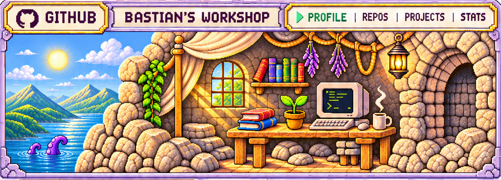
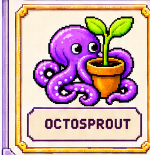
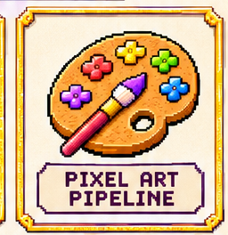
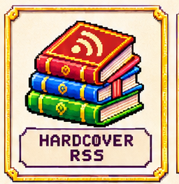
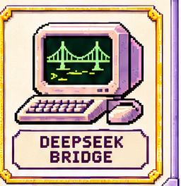
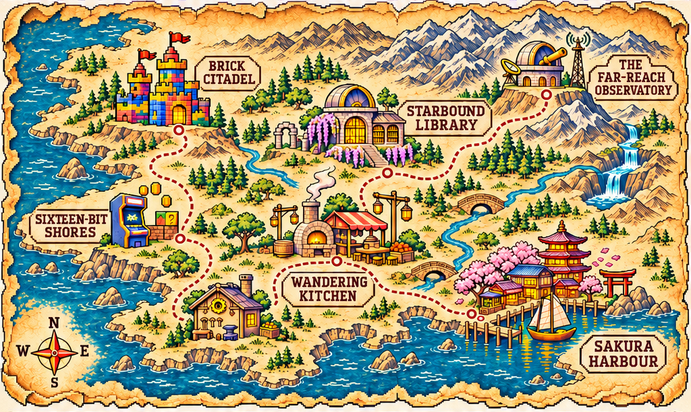
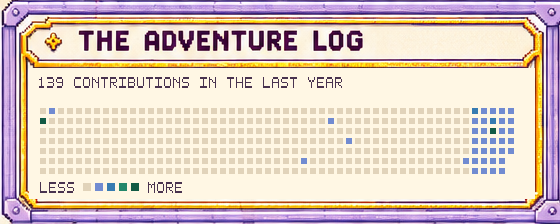
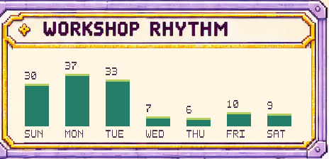

<picture><source media="(prefers-color-scheme: dark)" srcset="assets/profile/header.png"></picture>

<picture><source media="(prefers-color-scheme: dark)" srcset="assets/profile/inventory-heading.png"></picture> <a href="https://github.com/bfarkas/octosprout"><picture><source media="(prefers-color-scheme: dark)" srcset="assets/profile/octosprout.png"></picture></a><a href="https://github.com/bfarkas/pixelart-pipeline"><picture><source media="(prefers-color-scheme: dark)" srcset="assets/profile/pixelart-pipeline.png"></picture></a><a href="https://github.com/bfarkas/hardcover-rss"><picture><source media="(prefers-color-scheme: dark)" srcset="assets/profile/hardcover-rss.png"></picture></a><a href="https://github.com/bfarkas/deepseek-bridge"><picture><source media="(prefers-color-scheme: dark)" srcset="assets/profile/deepseek-bridge.png"></picture></a> <picture><source media="(prefers-color-scheme: dark)" srcset="assets/profile/inventory-footer.png"></picture>

<picture><source media="(prefers-color-scheme: dark)" srcset="assets/profile/map.png"></picture>

<picture><source media="(prefers-color-scheme: dark)" srcset="assets/generated/adventure-log-panel-dark.svg"></picture><picture><source media="(prefers-color-scheme: dark)" srcset="assets/generated/workshop-rhythm-panel-dark.svg"></picture>

