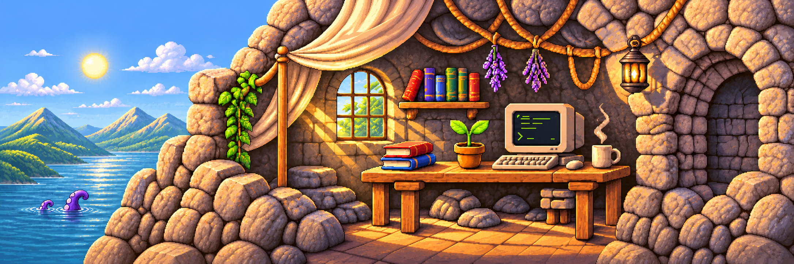
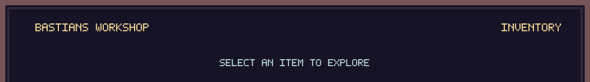
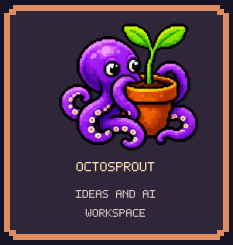
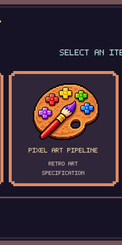
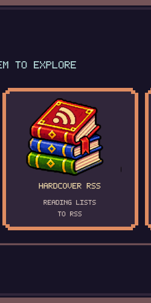
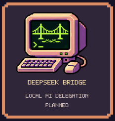
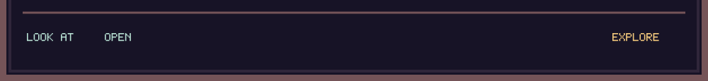
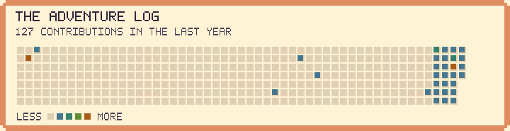
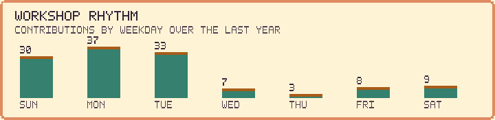

<picture>
  <source media="(prefers-color-scheme: dark)" srcset="assets/workshop-cropped.png">
  <source media="(prefers-color-scheme: light)" srcset="assets/workshop-day-cropped.png">
  
</picture>

# Hello, I'm Bastian 👋

Welcome to my corner of GitHub. Here you'll find experiments in AI-assisted tools, pixel art, reading, and embedded systems.

## ▸ Explore the workshop

## ▸ More from the workbench

I've also explored [running ROS on the ZedBoard](https://github.com/bfarkas/zedboard-ros). Take a look through my repositories for more projects and experiments.

## ▸ Adventure log

<picture>
  <source media="(prefers-color-scheme: dark)" srcset="assets/generated/adventure-log-dark.svg">
  
</picture>

<picture>
  <source media="(prefers-color-scheme: dark)" srcset="assets/generated/workshop-rhythm-dark.svg">
  
</picture>

Charts refresh daily from public GitHub contribution data. GitHub's own contribution calendar appears below.
